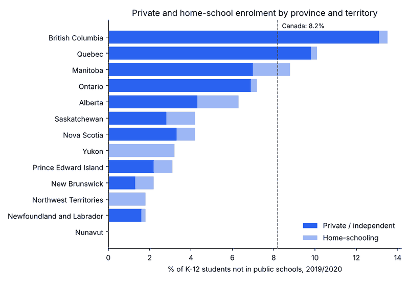

# Where Canadian K–12 students go to school (2019/2020)

How many elementary and secondary students in each province and territory attend public schools, private or independent schools, or are home-schooled. The data is Statistics Canada Table 37-10-0109-01.



## Findings

- **91.8%** of Canada's roughly 5.7 million K–12 students attend public schools. **7.6%** attend private or independent schools and **0.7%** are home-schooled.
- **British Columbia** has the highest private-school share, at **13.1%**. Quebec (9.8%) is next, then Manitoba (7.0%) and Ontario (6.9%).
- Home-schooling is most common in **Yukon (3.2%)**, **Alberta (2.0%)** and **Manitoba (1.8%)**.
- Ontario, Quebec and British Columbia together account for **86.5%** of all private-school students in Canada. Ontario alone accounts for 35.4%.
- Comparisons need care because provinces count differently:
  - Manitoba counts Catholic-school students as private.
  - Quebec, Saskatchewan and British Columbia include some adult programs.
  - Nunavut reports home-schoolers under public schools.

## Files

| File | Contents |
|---|---|
| `Stats_Can_Dataset.csv` | The Statistics Canada table as downloaded (header rows and footnotes included) |
| `src/analysis.py` | Parses the formatted table, computes shares and writes the outputs |
| `reports/school_type_by_region.csv` | Clean table by province and territory |
| `reports/summary.json` | Headline figures used above |
| `reports/non_public_share.png` | The chart |

## Run it

```bash
pip install -r requirements.txt
python src/analysis.py Stats_Can_Dataset.csv reports
```

Source: Statistics Canada, Table 37-10-0109-01. The figures are randomly rounded by Statistics Canada.

---
Reezwan-Us Sami · [Portfolio](https://reezwan95.github.io)
